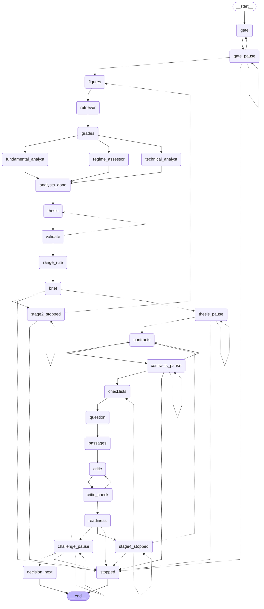

# Tradecraft workflow diagram

Generated from the LangGraph graph in `tradecraft/workflow/graph.py` by
`python -m tradecraft.workflow.diagram`. Do not edit by hand.

Solid arrows always run. Dotted arrows are choices: the user's action at a pause
(`*_pause`, `stage2_stopped`, `stage4_stopped`), the one-time return of a draft
(`validate` to `thesis`, `critic_check` to `critic`), or a stage stopping.
The three analysts run in parallel between `grades` and `analysts_done`.

